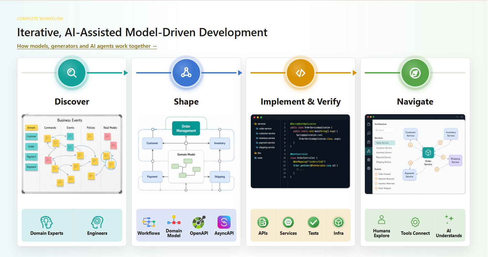

# zenwave-sdd

<picture>
  <source media="(prefers-color-scheme: dark)" srcset="images/iterative-model-driven-dark.png">
  <source media="(prefers-color-scheme: light)" srcset="images/iterative-model-driven-light.png">
  
</picture>

[Iterative Model-Driven development with ZenWave Domain Models and AI agents.](https://www.zenwave360.io/docs/ai-assisted-model-driven-development/) From EventStorming to working backend software in two loops:

- **Human in the loop (HITL).** 
  - Discover your business with Domain-Driven Design techniques along with agentic interviews.
  - Model your domain using: ZFL for the business flows, ZDL for each bounded context, OpenAPI and AsyncAPI for the contracts.
  - Navigate and explore your models using ZenWave Platform for VSCode
  - Challenge your models assisted by your best AI agents.
  - Generate Test data for each use case. Behaviour-Driven development by example.
  - Optionally generate a complete backend for Spring Boot (Java or Kotlin) with ZenWave SDK
  - Ask your agent to split it into tasks sliced vertically.
  - Iterate until you are ready to approve and hand over to the agentic loop.
- **Away from keyboard (AFK).** Once you approve and tag that baseline:
  - An orchestrator hands each task to
  - an implementer agent
  - and each finished slice to a reviewer agent
  - commits the work
  - stops to ask you only when the models turn out to be wrong
  - Follow it from your phone and interact with the orchestrator to get reports and insights about its work.

## The models are the specs

Model your specs in structured languages 

The models are the spec, so there is very little Markdown to read. The why is in the [MANUAL](MANUAL.md) and in the
articles [Reading Markdown is the bottleneck](https://ivangsa.com/articles/sdd-markdown-is-the-bottleneck/) and
[Two loops](https://ivangsa.com/articles/sdd-two-loops-model-driven-human-in-the-loop/).

## What you need

- Use [ZenWave Platform](https://www.zenwave360.io/zenwave-platform) to navigate your models and spec from VSCode
- [ZenWave SDK cli](https://www.zenwave360.io/docs/getting-started/) for linting your models and optionally generate complete Spring-Boot projects.
- For Spring Boot projects: a JDK, Maven, Docker.

## 1. Set up the project (once)

**1.1 Install zenwave-sdd** from a release tag. Run it again with a newer tag to upgrade, then review `git diff`:

```bash
TAG=<tag>
git clone -q --depth 1 --branch "$TAG" https://github.com/ZenWave360/zenwave-sdd ../zenwave-sdd-$TAG
bash ../zenwave-sdd-$TAG/install.sh            # --agents claude,codex,grok (default: all three)
```

It installs the skills for each agent (`.claude/skills`, `.agents/skills`, `.grok/skills`), the `orchestrator`,
`implementer` and `reviewer` agents (`.claude/agents`), and two checkers (`.zenwave/bin`: the ZDL lint and the board
check). It creates, only if missing, `docs/zenwave-sdd-overlay.md`, `.zenwave/routing.md`, `AGENTS.md` and `CLAUDE.md`.

**1.2 Fill in the overlay** and look at the routing if you plan to use a multi-agent/multi-model setup

- [`docs/zenwave-sdd-overlay.md`](templates/project-overlay.md): where the models are (in this repository, a sibling
  one, or a packaged jar), the shape (microservices or modulith), and the commands to compile, run the focused tests,
  run the full suite and lint the models. Every skill reads it first and stops if it is incomplete.
- [`.zenwave/routing.md`](templates/routing.md): which worker takes each kind of work (mechanical, bounded, advanced,
  review), who is the fallback, how Codex and Grok are started, how many tasks run at once, and which files no worker
  may change. Set it to the agents and subscriptions you have; change it any time.

```bash
grep -n '<' docs/zenwave-sdd-overlay.md     # no placeholder left
git add -A && git commit -m "chore: set up zenwave-sdd"
```

## 2. The HITL loop, for one business flow

**2.1 Discover the domain and draft the models** (a new project). Bring what you have: a brief or PRD, Event Storming
pictures, meeting transcripts.

```text
/zenwave-grill-domain docs/brief.md
```

It interviews you in rounds, with a recommended answer for every question, until the flows, bounded contexts,
commands, events, outcomes and rules are decided. When you confirm the understanding, it generates:

- `GLOSSARY.md`, with the ZFL and ZDL identifier of each term
- ADRs in `docs/adr/`
- `docs/domain.md`, a one-page summary with the list of flows
- one ZFL file per business flow
- one ZDL per bounded context, in your deployment shape, linted

You review and change them; nobody writes the first version by hand.

**2.2 Add a flow to an existing project** (code and models already there). Instead of 2.1, grill the new flow, then
bring the existing ZDL up to it:

```text
/zenwave-grill-domain docs/refund-flow-notes.md
/zenwave-extend-models refund-flow.zfl
```

`zenwave-grill-domain` interviews you about the new flow against the existing models, reusing their commands and
events where they fit. It generates:

- new `GLOSSARY.md` entries and ADRs
- the new ZFL flow

`zenwave-extend-models` reads the new flow and works out what each existing ZDL needs for it. It shows you the change
list first, each change as additive, behavior or breaking and what it touches (other flows, consumers, stored data).
After your go, it generates:

- the new commands, events, listeners and calls, in each existing ZDL
- the new entities, fields, enum values, states and transitions
- a new ZDL, only if you decided on a new bounded context

It changes nothing else in the existing ZDL, and lints them.

**2.3 Challenge the models.**

```text
/zenwave-grill-models place-order-flow
```

The agent lints the models and looks for contradictions, missing correlations, fields with no source, branches that
never end, side effects never compensated. It asks you about each one, and generates:

- the model changes you decide (it edits a model only when you ask it to)
- new ADRs and `GLOSSARY.md` entries

Meanwhile, review the projections in the ZenWave IDE plugin: flow and sequence diagrams per branch, state machines,
the API contracts. Repeat until there are no questions left.

**2.4 Generate** (ZenWave SDK projects).

> [ZenWave SDK](https://www.zenwave360.io/): *Model your domain. Generate the boring parts.* From ZDL, OpenAPI and
> AsyncAPI it generates Spring Boot services, event adapters (Kafka, Spring Cloud Stream, Spring Modulith), tests and
> infrastructure that stay aligned with the model. In production since 2022, Java or Kotlin, open source.
> [Getting started](https://www.zenwave360.io/docs/getting-started/).

Run the plugins of `zenwave-scripts.zw` from the IDE, or the `jbang zw`
command each one shows. It generates:

- entities, repositories, services, controllers, event producers and listeners
- the OpenAPI and AsyncAPI implementations
- unit and integration tests, with in-memory repositories and Testcontainers

Compile, look at the generated code, and if something is wrong, go back to the models: early code is throwaway code.
Commit when the structure is right.

**2.5 Test data**, the cases your tests start from (JPA projects):

```text
/zenwave-test-data
/zenwave-test-scenarios
```

`zenwave-test-data` writes one consistent example per entity. `zenwave-test-scenarios` writes a fixture for every
precondition, branch, failure and outcome of the flows. Together they generate:

- `data.sql`, with the scenario chains and their ids (`C-01`…) in its header
- the same data as JSON aggregates, for the in-memory unit tests
- the scenario and coverage matrices, for you to review

Once approved, agents never change them.

**2.6 The board.**

```text
/zenwave-tasks-from-code-and-models place-order-flow      # there is code: generated with ZenWave SDK or not
/zenwave-tasks-from-models place-order-flow               # there is no code yet
```

Tell it where everything is, if the overlay does not say: the ZFL file, the ZDL models, the API contracts, the code,
the test data.

```text
/zenwave-tasks-from-code-and-models place-order-flow
    zfl: ../arcadia-editions-architecture/business-flows/place-order-flow.zfl
    zdl: ../arcadia-editions-modulith-api/*-domain-model.zdl
    apis: ../arcadia-editions-modulith-api/*-openapi.yml
    code: src/main/kotlin
    test data: src/test/resources
```

It generates `docs/tasks.md` ([format](templates/board-format.md)):

- one vertical slice per path of the flow, the happy path first (the tracer bullet)
- each task with its model lines, its test data, its focused tests, its difficulty and what blocks it

Review it: the mistake to look for is a slice that is a layer ("all the mappers").

**2.7 The gate.**

```text
/zenwave-gate-check place-order-flow
```

It checks what can be checked (lint, proposals, test data, the board's DAG, the AFK setup, a clean tree) and asks you
to confirm what only you can: that the models were challenged, the projections reviewed, the test data and the board
approved. It generates:

- the gate checklist, filled in
- the commands to commit and tag the baseline, `baseline/<flow>-<n>`

The tag is the contract: the AFK loop works from it and never changes models, contracts or test data.

## 3. The AFK loop

An **orchestrator**, a Claude Code session you talk to, implements the flow from the approved board. It reads
`docs/tasks.md`, hands the ready tasks to workers, checks what they bring back, merges it, sends each finished slice to
a reviewer, and tells you how it goes. The workers are Claude subagents, Codex and Grok, and **you choose which one
takes each kind of work** in `.zenwave/routing.md`.

```bash
claude --agent orchestrator
```

**3.1 What it does.**

- It creates the branch `afk/<flow>` from the baseline tag in a worktree under `.zenwave/work/integration`, so your
  checkout is never touched.
- For every task it clones that branch into `.zenwave/work/<task>` (push disabled), writes a self-contained prompt, and
  starts the worker the routing picks for the task's difficulty, in the background. Tasks that touch different
  bounded contexts run at the same time; tasks in the same context, one after another.
- When a worker ends it does not trust the notification: it looks for the report on disk, reads it and the diff,
  checks that the approved models, contracts and test data are untouched, and runs the task's focused tests itself.
  Then it commits (unsigned, with `AI-Agent`, `AI-Model` and `AI-Orchestrator` trailers), merges into `afk/<flow>`,
  ticks the board, and deletes the clone.
- When every task of a slice is done, a reviewer runs the full suite, integration tests included, in a separate clone
  while work on the next slice goes on. It reports the model axis and the standards axis apart. A `FIX` becomes fix
  tasks on the same slice.
- A worker out of usage limit is noted with its reset time and skipped; the interrupted task goes to the next worker
  of the routing with a handoff of what was done.

Implementers write the failing test first from the approved fixtures, then the code, and run only the task's focused
tests.

**3.2 Talking to it.** It is a coworker. Ask it what runs and where, who found what in a review, what is blocked and
what waits for you; send it what you find while you test the running application, and it turns it into tasks; change
priorities, or the routing ("send the advanced tasks to Sonnet, Codex is out until six"). From your phone, with Claude
Code's remote access, it is the same conversation. Its state is the board, `.zenwave/handoff/<flow>/log.md` and the
clones, so a new session picks up from them.

**3.3 When the model is wrong.** A worker that cannot do its task with the approved models writes a proposal in
`docs/proposals/P-<nn>.md` (problem, evidence, options, a recommendation) and the task is blocked; the rest goes on.
The orchestrator tells you in three lines. Resolve it with `/zenwave-grill-models` on the proposal, change the models,
regenerate, update the test data and the board, and tag a new baseline.

**3.4 Done.** When every task is done, every slice reviewed and the suite green, the orchestrator checks the flow
once more against the models, archives the board to `docs/tasks/`, and tells you. Review and merge, signed:

```bash
git merge --no-ff -S afk/<flow>
```

Delete the brief or PRD the models came from, if it is still around: the models are the spec now, and an outdated
requirement only misleads the next agent. Next flow: back to 2.1, or 2.2 if the project now has code.

**Not included: unattended loops.** The orchestrator needs you to start it and, if it runs out of its own usage limit,
to restart it. If you want agents to run unattended, for a night on a server, a loop outside of this repository is the
tool for it. [Sandcastle](https://www.aihero.dev/sandcastle/branch-strategies) by Matt Pocock (MIT, TypeScript) runs
agents in a worktree inside a container and has loop templates; the board and the skills of zenwave-sdd work with it.

## Reference

| Skill | Loop | What it does |
|---|---|---|
| [zenwave-grill-domain](skills/zenwave-grill-domain/SKILL.md) | HITL | new project: interview from brief to glossary and ADRs, then a draft of every ZFL flow and ZDL model; existing project: the new flow's ZFL only |
| [zenwave-extend-models](skills/zenwave-extend-models/SKILL.md) | HITL | existing project: takes a new ZFL flow and adds to each existing ZDL what the flow needs, change list first |
| [zenwave-grill-models](skills/zenwave-grill-models/SKILL.md) | HITL | challenge the models; resolve proposals |
| [zenwave-test-data](skills/zenwave-test-data/SKILL.md) | HITL | one consistent example per entity, `data.sql` and JSON |
| [zenwave-test-scenarios](skills/zenwave-test-scenarios/SKILL.md) | HITL | a fixture chain per precondition, branch and outcome |
| [zenwave-tasks-from-code-and-models](skills/zenwave-tasks-from-code-and-models/SKILL.md) | HITL, exit | the board when code exists, from the code and the models; the final check |
| [zenwave-tasks-from-models](skills/zenwave-tasks-from-models/SKILL.md) | HITL, exit | the board when there is no code yet; the final check |
| [zenwave-gate-check](skills/zenwave-gate-check/SKILL.md) | gate | the checklist before tagging the baseline |
| [zenwave-implement-task](skills/zenwave-implement-task/SKILL.md) | AFK | one task, test first, focused tests only |
| [zenwave-review-slice](skills/zenwave-review-slice/SKILL.md) | AFK | one slice, full suite, model and standards axes |
| [zenwave-model-gap](skills/zenwave-model-gap/SKILL.md) | AFK, HITL | write a proposal instead of changing a model |

| In your project | What it is |
|---|---|
| `GLOSSARY.md`, `docs/adr/`, `docs/domain.md` | the language, the decisions, the domain summary |
| `docs/zenwave-sdd-overlay.md` | where the models are, the shape, the commands |
| `docs/tasks.md`, `docs/tasks/` | the board of the flow in progress, and the archived ones |
| `docs/proposals/` | model gaps waiting for, or with, your decision |
| `.zenwave/routing.md` | which worker and model take each kind of work, the limits, the protected files |
| `.zenwave/bin/` | the ZDL lint (`lint-zdl.sh`) and the board check (`check-board.sh`) |
| `.zenwave/work/`, `.zenwave/handoff/` | the orchestrator's clones, prompts, reports and logs (not committed) |

Licence: [MIT](LICENSE). The grilling skills include Matt Pocock's `grilling` skill verbatim, under its own MIT
licence ([templates/grilling/](templates/grilling/)).

Status: the skills and the orchestrator are new in this version and being validated on the Arcadia Editions and Pista
Aberta projects.
